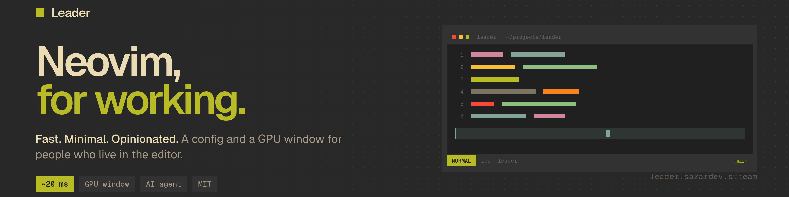
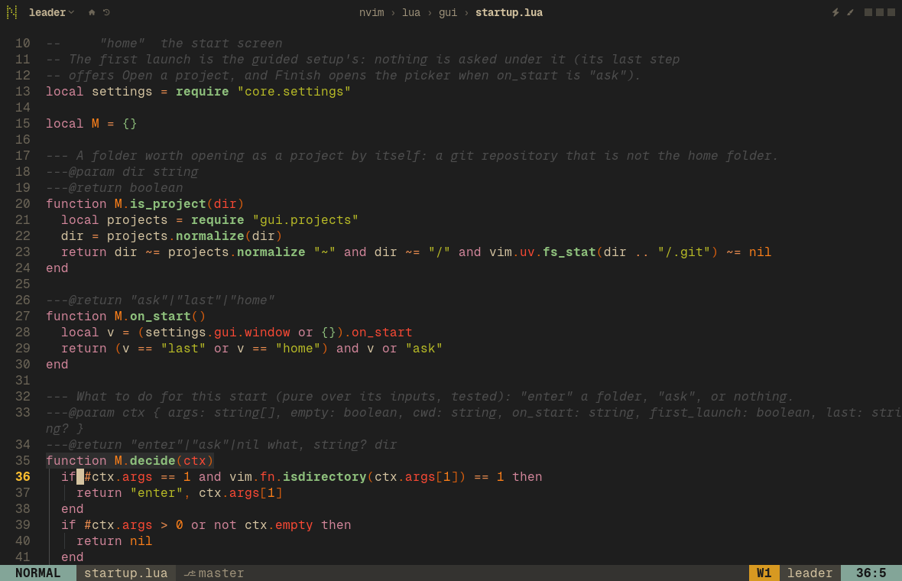
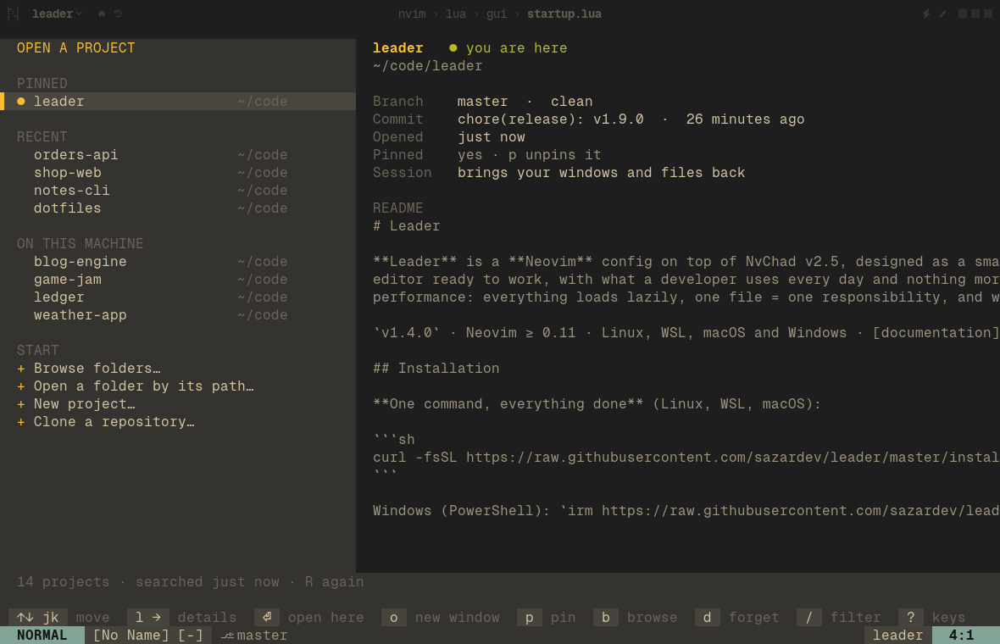
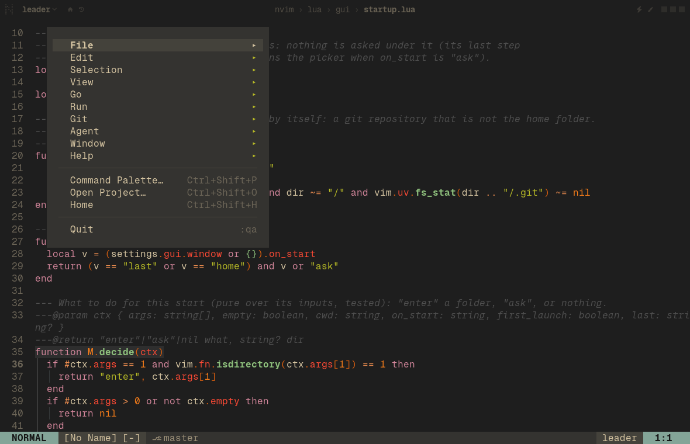
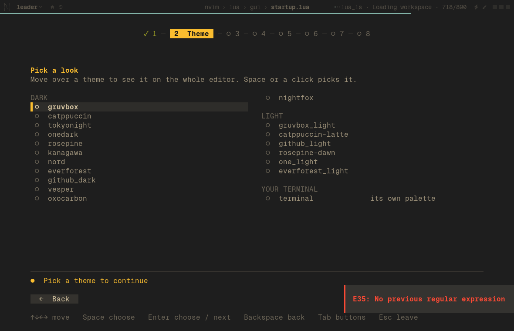

<!-- docs:skip -->
<p align="center">
  <a href="https://leader.sazardev.stream"></a>
</p>

<p align="center">
  <a href="https://github.com/sazardev/leader/releases/latest"></a>
  <a href="https://github.com/sazardev/leader/actions/workflows/ci.yml"></a>
  <a href="LICENSE"></a>
  <a href="https://leader.sazardev.stream/docs/"></a>
  <a href="https://github.com/sazardev/leader/discussions"></a>
</p>
<!-- /docs:skip -->

# Leader

**Neovim, for working.** Leader is a fast, opinionated Neovim config with its own GPU window (Rust + wgpu). It starts in
about 20 ms, gives you Zed-like menus, projects with their sessions and an inline AI agent that runs on the backend you
choose. **MIT, no telemetry, no account.**

**Linux** · **WSL** · **macOS** · **Windows** — the app on Linux/WSL, the config everywhere.

**Contents** · [Install](#install) · [Why Leader](#why-leader) · [FAQ](docs/FAQ.md) · [What's included](#whats-included) · [Keys](#keys-and-documentation) · [Community](#community)

## Install

```sh
curl -fsSL https://leader.sazardev.stream/install | bash
```

Windows (PowerShell): `irm https://leader.sazardev.stream/install.ps1 | iex`

That is the whole install: on Linux x86_64 it installs the desktop app, Neovim and the config; on macOS and Windows it
installs the config. It asks one thing — which language packs to set up — and can be re-run at any time. Prefer a
package? The [.deb](https://leader.sazardev.stream/deb) is one click; the [installer details](#what-the-installer-does)
are below.

## Why Leader

- **Fast by default.** ~20 ms to a usable editor. Every plugin waits for an event, a filetype or a key; nothing is
  resident until it has a reason to be.
- **One file, one responsibility.** A language is one file, a plugin is one file, an action is one file. You can read
  the whole thing and change one piece without a framework.
- **Everything is a key.** `<Space>` opens the menu for where you are, `<Space>Sp` changes the settings without editing a
  file, and every key is in [`CHEATSHEET.md`](CHEATSHEET.md), generated from the real keymaps.
- **Local first, no telemetry.** Static analysis and the completion helpers cost zero tokens. The agent runs on your CLI
  or a local model, only when you ask; no account, no analytics.
- **A real desktop, not a wrapper.** The same Neovim in its own GPU window: menus, a command palette, projects with
  sessions, a toolbar and a theme inherited from your terminal.
- **Open and yours.** MIT, Lua for the config and Rust for the app. Fork it, vendor it, change the opinions.

## Start here

| I want to… | Start with |
|---|---|
| **install Leader** | [one command](#install) · [Windows](#install) · [.deb](https://leader.sazardev.stream/deb) |
| learn the keys | [`CHEATSHEET.md`](CHEATSHEET.md) · press `<Space>` in the editor |
| read the guide offline | [open the single file](https://leader.sazardev.stream/offline) · the repo has it as `docs/offline.html` |
| ask a question or show something | [Discussions](https://github.com/sazardev/leader/discussions) |
| report a bug | [bug template](https://github.com/sazardev/leader/issues/new?template=bug_report.yml) |
| contribute | [CONTRIBUTING.md](CONTRIBUTING.md) · [ROADMAP.md](ROADMAP.md) |
| understand the code | [AGENTS.md](AGENTS.md) · [architecture](https://leader.sazardev.stream/docs/#internals) |

<!-- docs:skip -->

## Screenshots

<p align="center">
  
  
</p>
<p align="center">
  
  
</p>
<!-- /docs:skip -->

## What the installer does

The short link is a tiny script served by Cloudflare Pages: it picks the desktop package on Linux x86_64 and the config
installer everywhere else, so the same command is copy-paste on every machine. `LEADER_CONFIG_URL` and
`LEADER_RELEASE_URL` point it elsewhere if you mirror the assets.

It asks **one thing**: which languages to set up, as a checklist of packs (Go, Dart / Flutter, TypeScript / JavaScript,
C# / .NET, Web, Python, Rust, SQL, Swift, Java / Kotlin, Docker / Make / Prisma…) with the ones this machine already uses checked;
Enter keeps them. Only the languages you keep download their LSPs, formatters and linters (the base, Lua, Markdown,
JSON, YAML, TOML, is always on). Change them later in `<Space>Sp` → Languages. No clone needed: it fetches the repo into
`~/.local/share/leader` and does everything else (idempotent: run it again any time to bring it up to date):

1. installs whatever is missing from the system (git, curl, C compiler, ripgrep, node, cmake) and **Neovim ≥ 0.11** if you don't have it
   (in `~/.local/opt`, without `sudo`; with brew on macOS);
2. links `nvim/` as your config (`~/.config/nvim`); an existing one is moved to `nvim.bak-<date>`, never deleted;
3. enables the git hooks (`.githooks`: cheatsheet always up to date and conventional commits);
4. writes your **per-machine settings** (`nvim/lua/local.lua`, git-ignored): the languages you chose and the options below;
5. installs the plugins at the versions pinned in `nvim/lazy-lock.json` (in parallel), the LSPs/formatters/linters (Mason) and builds the
   treesitter parsers (`tree-sitter-cli` comes from Mason), reporting the time each step took;
6. creates the `leader` command (`~/.local/bin/leader`: in a terminal it is `nvim` itself, same arguments and exit code);
7. **sets up the AI agent** with the best backend it finds (Claude Code, OpenCode, Ollama…); `--agent none` skips it.

Options go after `bash -s --`, for example a Go laptop, fully configured:

```sh
curl -fsSL https://leader.sazardev.stream/install | bash -s -- --lang go,sql --theme gruvbox
```

Prefer to clone it yourself (to hack on it)? `git clone https://github.com/sazardev/leader && cd leader && ./install.sh` does exactly
the same. Override the fetch with `NVIM_CONFIG_DIR`, `NVIM_CONFIG_REPO` and `NVIM_CONFIG_BRANCH`.

Then open `nvim` — or `leader`, which the installer also creates (`~/.local/bin/leader`): in a terminal it is `nvim` itself. Press `<Space>` and which-key shows you the menus.

There is also a landing page, `docs/index.html` (flat and square like the config, no build, self-hosted Geist in `docs/fonts/`, dark/light with `t`), and the documentation at `docs/docs/index.html` (generated from the Markdown by `scripts/gen-docs.sh`). Both are live at **https://leader.sazardev.stream/** on Cloudflare Pages (`npx wrangler pages deploy docs --project-name leader --branch=master`; see [AGENTS.md](AGENTS.md) for the short links, headers and SEO files). To try them locally: `cd docs && python3 -m http.server`.

| Option | Effect |
|---|---|
| `--ask` | prompts before installing system packages or Neovim (by default it asks nothing) |
| `--lang python,sql` | those packs (`go dart typescript csharp web python rust sql swift jvm infra yarnspinner`) or single languages, `all` for every one; skips the checklist |
| `--yes` | asks nothing: the packs found on this machine (also what happens with no terminal) |
| `--theme catppuccin` | default theme (`local.lua`) |
| `--light` / `--no-light` | forces light mode (no resident LSP) or turns it off; without this it is detected by RAM (≤ 2 GB) |
| `--agent auto` | the AI agent (`auto` is the default and picks the best available), `claude/haiku`, `ollama/qwen2.5-coder:7b@light`…; `none` skips it |
| `--no-deps` | doesn't touch system packages or Neovim |
| `--no-plugins` | only links; plugins and tools install themselves the first time you open nvim |
| `--dry-run` | shows what it would do |

```sh
./install.sh --lang go,sql --theme gruvbox --agent claude/haiku   # from a clone: a Go laptop, everything configured
./install.sh --dry-run --no-deps --lang rust                      # see what it would do
```

Single languages also work with `--lang`: `lua go typescript csharp html css tailwind json yaml toml markdown docker prisma astro dart rust python java kotlin sql swift make yarnspinner`.
If `local.lua` already exists it is **left untouched**: the installer tells you what to add (it is yours and may hold other settings).

**Native Windows** (PowerShell): `./install.ps1 [-Lang go,typescript] [-Theme x] [-Light|-NoLight] [-Agent auto] [-NoPlugins]` creates the
junction at `%LOCALAPPDATA%\nvim` and does the same steps (written but not tested on real Windows; on WSL use `install.sh`).

**Uninstall**: delete the `~/.config/nvim` link (and, if you want, `~/.local/share/nvim`, `~/.local/state/nvim`, `~/.cache/nvim`).

### Desktop app (Linux, WSL)

The same editor in its own window: `leader`, a GPU front-end for Neovim written in Rust (`app/`). It runs your Neovim
with this config, so everything above works the same, but it draws the screen itself instead of a terminal: one
draw call per frame, nothing running between keystrokes, and the flat design's half cells and borders drawn as exact
rectangles. Add `--app` to the installer (or run `app/install.sh` from a clone): it installs Rust with rustup if needed,
builds `leader` and adds **Leader** to the application menu (`~/.local/bin/leader`, `~/.local/share/applications`).

From a release, in one command (Linux x86_64, glibc 2.31+: Ubuntu 20.04, Debian 11, Fedora 32 and newer; WSL with
WSLg): it downloads the package, checks it, installs the app and, when they are missing, Neovim and this config; the
first launch shows the welcome screen.

```sh
curl -fsSL https://github.com/sazardev/leader/releases/latest/download/leader-installer.sh | bash
```

From a package: **Debian, Ubuntu, Mint, Pop!_OS** download `leader-editor-amd64.deb` from the
[latest release](https://github.com/sazardev/leader/releases/latest) and `sudo apt install ./leader-editor-amd64.deb`;
**Arch, CachyOS, Manjaro** use the PKGBUILDs in [`packaging/arch`](packaging/arch) (`leader-editor-bin` prebuilt,
`leader-editor` from source; `makepkg -si`). The packages add the menu entry, the icons, the manual (`man leader`) and
`leader-setup`, which installs the config for your user (the first launch with no Neovim config runs it in the window).
Every release is signed and checksummed: how to verify it in [`packaging/README.md`](packaging/README.md).

From a clone:

```sh
./install.sh --app          # the config + the desktop app (built from source)
app/install.sh --uninstall  # remove the app (the config stays)
```

- In a terminal, `leader [files…]` is `nvim` itself (any `nvim` argument works); from the menu (or with `leader --gui`) it opens the window. Files dropped on the window open in it.
- The system clipboard works on its own (`"+y`, `"+p`, `Ctrl+Shift+V`), no wl-copy/xclip/OSC 52 needed.
- Its own title bar, painted with the editor's background so it is part of it (it steps back while a modal such as Telescope is open), in a smaller type than the code, laid out like Zed's. Leader's dotted N (it ripples on hover; also `F10`) opens the **app menu**: File, Edit, Selection, View, Go, Run, Git (inside a repo), Agent, Window and Help, each a submenu whose items do exactly what Leader's own keys do and show them, plus the **command palette** (`Ctrl+Shift+P`: every menu item and every key of the config in one search). The project's name opens the **projects menu** (every folder you worked in, newest first; switching saves the session and restores the other project's, unsaved files are never dropped) and **Open Project…** (`Ctrl+Shift+O`) a full-screen picker: your recent projects and every git project under your home, with the one under the cursor described on the right (branch and changes, last commit, when you opened it, whether a session brings your windows back, its stack, its README); ⏎ opens it, `o` in a new window, `d` forgets it, plus a folder by path, a new project or a clone. ⌂ goes to the start screen, ↺ opens your recent files. Center: the current file's path, every part clickable. Right, live: what is running (LSP indexing with its progress, installs, a save: a dot spinner and a thin progress line), what is left to install, a macro being recorded, the file's git changes, unusual encodings or line endings; then minimize · maximize · close as three small flat squares. Configure it in `gui.appbar`: `controls`, `buttons = { mark, project, home, history }`, `activity`, `show`, `enabled = false` for the system's title bar.
- Full mouse: everything you can choose follows the pointer and answers a click. Menus light up the item under the pointer and open submenus as you pass over them; the project picker (and every full-screen list of the config) selects the row under the pointer with its details beside it, opens it on a click, and its key chips are buttons; modals light up their buttons; Telescope (the palette and every picker) selects on hover and opens on a click; the file tree opens a file or a folder with one click; the start screen's buttons follow the pointer. Over menus and pickers the pointer is an arrow, over text an I-beam.
- A **guided setup** opens on the first launch, full screen, in seven steps (each one says what it still needs and Next waits for it; keyboard or mouse): what this machine is (distro, package manager, GPU), a theme (previewed live as you move over it), your languages (the ones this machine uses already checked), a few features, an AI agent (the ones found here with their models, or one to install), what to install (missing system packages with the exact command for pacman, apt, dnf, zypper or apk, Leader's plugins, language tools and parsers, and the agent you asked for: nothing runs until you press Install, sudo asks in a terminal, each item shows its status) and a review with the install checks. It comes back with `Ctrl+Shift+W`, Help › Welcome or the bar's "to finish" chip. Full-screen lists such as Open a project mark the chosen row with a bar and move with the arrows or hjkl.
- **Updates, connected:** Leader looks for a newer version now and then (one tiny request, never more than every 12 hours, off with `update.enabled`) and shows a `↑ 1.9.0` badge in the bar and a line at the top of the logo's menu. Click it for what changed, version by version, and update on request: the config is pulled with git (never merged or discarded), the plugins restored to the lockfile, the desktop app updated through its installer, and Leader offers to restart. `Skip` hides a version until a newer one; Help › Check for Updates looks right now.
- **Projects first, like an IDE:** started from the menu, Leader asks which project to open (or reopens the last one, or shows the start screen: your choice); `leader ~/code/app` opens that folder as the project. Pin the ones you use (`p` in the picker) to keep them at the top, or walk your folders Yazi-style (`b` in the picker: `h` up, `l` in, `⏎` open). Recent files (`Space f o`, the start screen) are the ones of the project you are in, not everything you ever opened; `Ctrl+A` there widens it to every project. The window comes back with its size, place and maximized state, and its frame is yours to pick (Leader's square bar or the system's).
- **Panes**: `Alt+V` / `Alt+H` open a real Neovim split with the **start screen** in it, so `ff`/`fo` load the chosen file in that pane; the dashboard is per pane, `Ctrl+h/j/k/l` moves, `Alt+arrows` resizes, `Alt+Z` zooms and `Alt+Q` closes. `<leader>V` lists them and has equal sizes, rotate and swap. See [panes.md](docs/cheatsheets/panes.md).
- **A toolbar you decide**: a right click on the bar (or View › Customize Toolbar) turns each tool and chip on or off: project, home, recent files, command palette, file tree, terminal, problems, agent (pick the agent and model right there), theme (light/dark, the terminal's theme, a dark and a light list previewed as you hover, the whole catalog), settings, setup. Every tool shows a tooltip with its key.
- Window keys: `F10` app menu, `Ctrl+Shift+P` command palette, `Ctrl+Shift+O` open a project, `F11` fullscreen, `Ctrl+Shift+Enter` maximize, `Ctrl+Shift+M` minimize, `Ctrl+Shift+N` new window, `Ctrl+Shift+H` home, `Ctrl+Shift+R` recent files, `Ctrl+Shift+W` welcome and checks.
- Font: `gui.font` in `core/settings.lua` (`guifont` syntax, `"Family:h13"`) and `gui.font_weight` (400 regular, 500 medium…; the app applies it live); `Ctrl+=` / `Ctrl+-` / `Ctrl+0` resize it. `options.linespace` (2 px) adds air between lines in the desktop app; a terminal owns its own line height and weight (`font.normal.style` in Alacritty).
- WSL: it opens through WSLg on the Windows GPU (Mesa's d3d12 driver), with no setup.
- `LEADER_TIMING=1 leader` prints where the startup time goes (~170 ms to the first frame on WSLg, GPU start included).

## Philosophy

- **Fast**: ~20 ms startup (measured headless, with `--startuptime`); `defaults.lazy = true`, plugins loaded by event/filetype/command/key, bytecode cache (`vim.loader`) and unneeded built-in plugins disabled.
- **Minimal**: 54 entries in `lazy-lock.json`, **counting** dependencies and NvChad's own. No heavy session manager, no tab bar, no embedded AI chat, no LSP dependency tree for things you don't use.
- **Modular**: the config is *declared*, not wired. Adding a language, a plugin, an agent action or a Go helper means creating one file; nothing else is touched.
- **Spend the minimum**: whatever can be decided without a model is decided beforehand (gates, local analysis, treesitter completion); when one has to be called, only what is needed is sent and the cost is shown.
- **Light where it matters**: with ≤ 2 GB of RAM the resident processes (LSP, golangci-lint) are turned off automatically; force it with `NVIM_LIGHT=1|0`.
- **Everything by keyboard**, with keys documented and generated from the real code.

## What's included

| Area | Contents |
|---|---|
| Languages | Go, TypeScript/JS/TSX, HTML/CSS/Tailwind/Astro, Python, Rust, SQL (PostgreSQL, SQLite), Swift (SwiftPM), Dart/Flutter, Java/Kotlin, Lua, Markdown, JSON/YAML/TOML, Docker, Make, Prisma, YarnSpinner. Each one declares its LSP, formatter, linter, parsers and its `<leader>` menu (it only exists in buffers of that filetype). Python, TypeScript, Rust and Swift share **tests in the editor** (the test under the cursor, marks per test, failures on their line), **project setup** presets and **debugging**; SQL runs the statement under the cursor against your database |
| Editing | **undo word by word** (like VS Code), `U`/`Ctrl+Y` redo, undo tree, the file at the previous save, a clipboard that `x`/`c` don't overwrite and a **yank history** (`[y`/`]y` after a paste, `<leader>uy`), blink.cmp, optional **local FIM completion** (Qwen2.5-Coder 1.5B), mini.pairs/surround/move, multicursor, flash (jumps), treesitter textobjects, folds (ufo) with foldable long comments, custom snippets |
| Navigation | Telescope (+fzf), nvim-tree, harpoon, aerial (symbols), grug-far (global replace), file history |
| Git | gitsigns, diffview, git-conflict, git-blame (off by default) and **conventional commits** (see below) |
| Diagnostics | inline blocks under their line, line number colored by severity, unique colors across the whole UI, line popup, copy as text (line, file or project), Trouble |
| UI | **flat design** (floats, menus and pickers are filled blocks, no boxes; every color derived from the theme, notifications, yank/accept flash), lualine, gruvbox ↔ light theme **or live-inherited from the terminal** (Alacritty), dashboard with braille art, render-markdown, inline colors |
| Sessions | one per folder and branch, periodic autosave, restored automatically on a bare start (terminals included) |
| **Go without an LLM** | completion helpers that read your code and your `go.mod` (see below) |
| **Dart / Flutter** | run with an entry-point picker, debugging, tests inside the editor, build_runner watch, Riverpod/freezed completion (see below) |
| **AI agent** (optional) | `<leader>a`: one-shot actions on the function under the cursor, with an inline diff (see below) |
| **Herdr** (optional) | `<leader>W`: the workspace of agents — what every one of them is doing, live, and the setup (see below) |

### Commits (`<leader>G`)

A **single panel** for committing: what goes in (staged vs not staged, with +/− per file), the message with **live Conventional Commits
validation** (`✔ feat(scope) · 38/72`), assisted type and scope, and a line saying what the agent will do *before* spending anything.
`Gc` opens the panel, `Gm` opens it with the AI draft, **`GM` commits on its own, in the background** (stages what is modified except sensitive files,
the AI writes ONE message in English, it is validated and committed; if anything fails, it undoes what it staged) and `Ga` rewrites the last one. The
AI message is always in English, on one line, in ~2 s with a light model.

The remotes are there too: `GP` pushes (setting the upstream the first time), `Gu` pulls with `--ff-only` (a divergent
branch is reported, never merged behind your back) and `GF` fetches every remote with `--prune`. They run in the
integrated terminal, so credentials, SSH passphrases and hooks work, and `Esc` closes the window without stopping
the command.

### GitHub (`<leader>Gh`)

The `gh` CLI and its TUIs, one key each: **`d`** [gh-dash](https://github.com/dlvhdr/gh-dash) (PRs and issues in one
dashboard), **`o`** [gh-observer](https://github.com/fini-net/gh-observer) (the current PR's checks, live), **`e`**
[gh-enhance](https://github.com/dlvhdr/gh-enhance) (Actions runs and logs) and **`n`**
[gh-news](https://github.com/chmouel/gh-news) (notifications). Each lives in its own terminal: the same key brings it
back while it runs, `Esc` closes the window and it keeps running. The first launch of a missing extension shows the
exact `gh extension install …` command and does both after you confirm; `s` is the checklist of all of them. **`p`**,
**`i`** and **`r`** use [octo.nvim](https://github.com/pwntester/octo.nvim) for PRs, issues and reviews inside
Neovim, and `v`/`c`/`b`/`a`/`A` cover the core commands (PR in the browser, checks, repo, auth status/login).
Details in [docs/cheatsheets/github.md](docs/cheatsheets/github.md).

### AI agent (`<leader>a`)

It is not a plugin: it is Lua code in this config, with no dependencies, and it does nothing until you invoke it. Claude Code, OpenCode, **Ollama (CPU/CUDA)**,
LM Studio/llama.cpp/vLLM and other CLIs; it detects and configures its backends on its own (`<leader>am` → Setup, or `./scripts/agent-setup.sh`).
A short generic menu and one menu per **level**, each with its own folder and actions:

| Menu | What it does |
|---|---|
| `<leader>a` | implement, review, explain, ask, document, refactor, **`t` convert** (JSON, SQL or curl into code for the file's language), hand off to Herdr; **`f` inline fix** (the line's diagnostic, with the type of what it points at) and **`F` block fix** (the whole function) |
| `aT` **tests** | `w` writes only the missing tests at the end of the test file · `m` mock · `f` fixes a test by running it first (if it already passes, 0 tokens) · `g` gaps (local) |
| `aL` **lenses** | security, performance, concurrency, errors, API compatibility: single-focus reviews as diagnostics; each one first discards what is not its concern |
| `aD` / `aP` / `aU` | hexagonal architecture: domain, repositories and services, with local 0-token analysis |
| `aS` **setup** | the documents agents read before they code: **AGENTS.md** (from the project, or a 0-token template), **STACK.md** (82 stacks in 10 kinds of project, games, data / AI and Neovim plugins included: Go stdlib/chi/Fiber/Huma, Bun + Hono, FastAPI, Axum, Next.js, Vite, Solid, Alpine.js, Flutter (Riverpod, Bloc, Supabase, offline-first, desktop), Bubble Tea and Ratatui TUIs, self-hosted Go + SQLite / PocketBase / Docker Compose…; then **customize**: Bun or npm, TypeScript 7, Biome/Oxlint, Tailwind 4, deploy (Docker self-hosted, Coolify, Fly, systemd, Kubernetes, Cloudflare, Vercel, stores, GoReleaser), CI, observability, quality; plus checked principles: SOLID, Clean Code, hexagonal, one file one responsibility…), **DESIGN.md** (17 design systems (Material 3, Ant, Fluent, Carbon, Atlassian, Polaris, Radix, Mantine, Geist…), 13 styles and 9 terminal designs; styles: neo-brutalism, Swiss, retro pixel, glass, mono minimal; terminal / TUI: ASCII art, Braille, brutal, classic, retro CRT, modern; then customize platforms, theme, palette, motion, effects, glyphs, density and accessibility; or described in your words) and **SPEC.md** (write it any way, it comes back with requirements, acceptance criteria and open questions; then add **modules** for what every app repeats: accounts, roles, lists, workspaces, notifications, audit log, uploads, import/export, offline, payments, subscriptions, with their edge cases and the questions only you can answer); then **build** from them: the whole project, one layer (foundation from STACK.md, domain from SPEC.md, design from DESIGN.md), **one feature** (a requirement of SPEC.md, or a new one you describe) or a **recipe** (prefab tasks per stack: a Flutter screen with its state, a Go endpoint, an entity with its repository…); **coverage** for free (which requirements have a test, what drifted from the documents), and every build leaves its decisions as ADRs and a PROGRESS.md the next agent reads |
| `aA` **advanced** | **several at once** (`a` fix all, `o` / `O` fix from output, `p` plan; kept out of the everyday `<leader>a`): fix all the file's findings (one request per function), fix what a build printed (the last terminal, the quickfix or a command), a plan across files you edit before it runs; the proposals wait in a queue (`]` `[` `y` `l`) |
| `GR` | **release**: the changelog and the next version from your Conventional Commits (0 tokens), a PR description (one light request, to the clipboard), a release checklist from STACK.md's quality gates |
| `Gv` | **review what is staged** before committing: secrets and leftovers for free, the code once, findings as diagnostics |

Around the proposals: **`Tab` refines** one instead of starting over, accepted code is **verified** for free (the LSP's new errors are compared with the old ones and
it offers one more attempt with them), and a **spend guard** checks every request against your own history (it asks above a size, blocks at the caps you set).
Also: clear findings one at a time, per file or all of them (`<leader>ac`, `aC`, `:AgentClear`), history in markdown with the code sent, filters and back navigation
(`<leader>ah`), models per tier (cheap where it is enough). Details in [docs/cheatsheets/agent.md](docs/cheatsheets/agent.md).

### Herdr (`<leader>W`)

[Herdr](https://herdr.dev) is the terminal workspace that runs the coding agents. Leader reads it through its CLI:
`<leader>Wa` opens the **breakdown of the workspace** — one row per agent (its state, its kind, where it is), the
transcript of the one under the cursor and **why Herdr thinks it is in that state**, refreshed on its own. `f` brings
the agent's pane to the front, `s` sends it a prompt. `<leader>Ws` is the setup: it detects the binary, the server and
the agents' integrations, and installs what is missing (nothing without pressing the button).

It also goes the other way: with the registration on, this nvim appears in Herdr's Agents panel **saying what it is
doing** (`working` while the agent runs, `blocked` while a proposal waits for you), and Herdr 0.10+ brings the pane
back with your session after a server restart. Details in [docs/cheatsheets/herdr.md](docs/cheatsheets/herdr.md).

### Go without an LLM (smart completion, 0 tokens)

On top of a shared index (`utils/goindex.lua`: treesitter + `go.mod`, cached by date):

- **missing methods** to satisfy an interface, with the exact signature and bodies that call your dependency (`return s.repo.FindByID(ctx, id)`);
- **`if err != nil`** with the zero values of the function's returns and a message taken from what is called (the menu opens by itself after `x, err := …`);
- **mappers** between layers (`NoteResponse` ↔ `Note`), **constructor wiring** (`NewNoteService(noteRepo)` with the arguments resolved),
  **enum helpers** (`IsValid`, `Parse`, `UnmarshalText`…), **interface from a struct** and `var _ I = (*T)(nil)`,
  **HTTP handlers** from a service (net/http, chi, gin, echo);
- **getters** of the private fields (slices and maps as copies), **`Reconstitute`** (the persistence constructor), the domain's
  **repository port** and `package` ranked by the folder (`main` only where it makes sense);
- struct tags, constructors, filled literals, sentinel errors, statement snippets. Details in [docs/cheatsheets/go.md](docs/cheatsheets/go.md).

### Dart / Flutter (`<leader>d`)

- **run and debug** through nvim-dap, with a picker of entry points (`lib/main*.dart`, the last one first) and the device in the
  statusline; hot reload on save, the app's log in a split that keeps your focus;
- **tests inside the editor**: the test under the cursor, the file or everything, a mark per test line, failures as diagnostics on
  the `expect` that failed, quickfix; `<leader>dT` jumps between a file and its test;
- **code generation**: `build_runner watch` in the background with its state in the statusline and its errors on their line;
  saving an `.arb` runs `gen-l10n`;
- **completion for your stack**, read from `pubspec.yaml`: Riverpod providers, freezed classes, Consumer widgets, named after the
  file and with their `part` lines; **pub outdated** written next to each dependency, `pub add`.
  Details in [docs/cheatsheets/dart-flutter.md](docs/cheatsheets/dart-flutter.md).

## Customizing

Everything configurable is in `nvim/lua/core/settings.lua` with its default value and a comment. Your changes go in
`nvim/lua/local.lua` (git-ignored, merged on top; the installer can generate it with `--lang`, `--theme`, `--light`):

```lua
-- nvim/lua/local.lua
return {
  theme = { name = "catppuccin" },
  languages = { disabled = { "astro", "dart", "java", "kotlin" } },
  agent = { backend = "ollama", tiers = { lens_security = "light" } },
  git = { commit = { subject_max = 60 } },
}
```

You do not have to edit a file for the everyday ones: **`<leader>Sp` opens the settings panel** (theme, motion, cursor,
format on save, diagnostics layout, answer language, light mode, plugins, tools, update…). `Enter` flips a value and applies it
at once when it can (the few that need a restart say so); your choices are kept apart (`stdpath("state")/prefs.json`),
win over `local.lua`, and "Reset my choices" forgets them. Keys of their own: `St` theme, `Sf` format on save, `Sl`
plugins, `SM` tools, `Si` info, `Su` update the config.

Files have the same treatment: **`<leader>F`** (and `a` / `r` / `d` inside the tree) creates, renames, moves, duplicates and
deletes in flat modals that show where the file will land. Several files at once (`a.go; b/c.go; d/`), a name with `/`
moves it, the move is a folder picker, and **delete goes to a trash** (`<leader>Fu` brings the last one back). Open buffers,
language servers and the tree follow a rename; your unsaved changes survive it.

To add (each one is **a single file** and, at most, a name in its `NAMES` list):

- **a language**: `nvim/lua/languages/<name>.lua` (contract at the top of `languages/init.lua`);
- **a plugin**: a file in `nvim/lua/plugins/<group>/`;
- **a dashboard art**: `nvim/lua/ui/arts/<name>.lua` (braille only);
- **an AI backend**: an entry in `agent.custom` (no code) or `nvim/lua/agent/backends/<name>.lua`;
- **an agent action, lens or test**: `agent/actions/`, `agent/lenses/actions/` or `agent/tests/actions/`;
- **a per-language test convention**: `agent/tests/convention.lua`;
- **a Go completion helper**: a `utils/go<name>.lua` module on top of `goindex` and its call in `gosmart`.

## How it is organized

The principles (the same across the whole repo) and where they show:

- **One responsibility per module**: the pure parts (`commit/conventional.lua`, `utils/goindex.lua`, `agent/protocol.lua`) kept apart from what touches
  git, the LSP or the UI (`commit/git.lua`, `commit/panel.lua`); one presenter per output kind (`agent/output/`).
- **Open for extension, closed for modification**: discovered registries (`languages/`, `agent/actions/`, `agent/backends/`, `agent/lenses/`);
  adding one doesn't force editing the others. The agent pipeline is extended with action hooks (`retarget`, `merge`, `reveal`, `prepare`), with
  guards (`agent/guards/`) and with events (`agent/events.lua`: verification, batches and the proposal queue subscribe; the presenter that accepts a proposal knows none of them).
- **Dependencies point to abstractions**: each piece talks to a small contract (a backend's `build`/`parser`, a context provider's `collect(target, done)`,
  a Go helper's `declaration_items(range, frag)`), not to its neighbor's implementation.
- **Configurable things in a single place**: `core/settings.lua`; the scripts (`install.sh`, `install.ps1`) share the same settings logic
  (`scripts/install-local.lua`) instead of duplicating it.

## Keys and documentation

- **[The documentation site](https://leader.sazardev.stream/docs/)**: everything below in one searchable page (`/` to search). It is generated from these Markdown files (`scripts/gen-docs.sh`; the pre-commit hook regenerates it).
- **[The offline guide](https://leader.sazardev.stream/offline)**: the same documentation in **one HTML file** with the fonts embedded, no network needed. The file is `docs/offline.html` (`scripts/gen-offline.sh` keeps it up to date).
- **[The FAQ](docs/FAQ.md)**: short answers about installation, platforms, the agent, privacy, updates, sessions and offline use.
- **In the app**: Help → *Documentation* opens the site; Help → *Offline Guide* opens the single-file guide from the clone (or the live copy).
- [`CHEATSHEET.md`](CHEATSHEET.md): **all** the keys. It is generated from the real keymaps (`scripts/gen-cheatsheet.sh`; the pre-commit hook regenerates it). Inside nvim, the dashboard's *Mappings* button shows the same.
- [`docs/cheatsheets/`](docs/cheatsheets/README.md): what the code doesn't say (workflows, tools, pitfalls), one page per language and the agent's.
- [`AGENTS.md`](AGENTS.md) / [`CLAUDE.md`](CLAUDE.md): architecture and pitfalls for whoever touches the config (people or agents).

## Structure

```
install.sh · install.ps1      installation (Linux/WSL/macOS · Windows)
VERSION                       config version
nvim/                         the config (what gets linked)
  init.lua                    bootstrap only
  lua/core/                   settings, options, keymaps and startup autocmds
  lua/languages/              one file per language (declared; not wired)
  lua/plugins/<group>/        one lazy spec per plugin
  lua/menus/                  contextual leader menus
  lua/agent/                  AI agent: backends, actions, context, output, tests, lenses, ddd, setup
  lua/commit/                 commits: validation (pure), git, AI draft, panel
  lua/utils/                  utilities; go*.lua = Go completion helpers on top of goindex
  lua/ui/ appearance/ themes/ dashboard, theme, colors
  lua/prefs/                  settings panel (<leader>S): one file per group of toggles in items/
  lua/files/                  file operations (<leader>F): paths, file system, buffers, modals
  lua/panes/                  panes: real splits with the start screen (Alt+V / Alt+H, <leader>V)
  snippets/ ftdetect/ syntax/ custom snippets and filetypes
scripts/                      installation (install-*.lua), cheatsheet, agent setup and tests
docs/cheatsheets/             per-language and agent documentation
.githooks/                    up-to-date cheatsheet + Conventional Commits
```

## Maintenance

- Update: re-run the install command (or `git pull && ./install.sh`): it brings the plugins to the versions pinned in `lazy-lock.json`; the config reloads itself when nvim opens.
- Check: `scripts/test.sh` runs everything (agent and commits, Go helpers, installer and up-to-date cheatsheet; no network or tokens); each
  suite can also be run on its own: `scripts/test-agent.sh`, `scripts/test-go.sh`, `scripts/test-install.sh`, `scripts/gen-cheatsheet.sh --check`.
- Commits: Conventional Commits format (`feat(scope): subject`); the `commit-msg` hook validates it and `<leader>Gc` / `Gm` / `GM` assist with it.

## Community

Leader is open source and maintained in public. There is no company behind it, no telemetry and no paid tier.

- **[Discussions](https://github.com/sazardev/leader/discussions)**: questions, setup help, ideas, what you built.
- **[Issues](https://github.com/sazardev/leader/issues)**: reproducible bugs and scoped feature requests (with templates).
- **[Contributing](CONTRIBUTING.md)**: development setup, tests, commit style and the pull request checklist.
- **[Code of Conduct](CODE_OF_CONDUCT.md)**: the rules of the community.
- **[Support](SUPPORT.md)**: where to ask and what to include; **[Governance](GOVERNANCE.md)**: how decisions are made.
- **[Roadmap](ROADMAP.md)**: now, next, later and what is explicitly not planned.
- **[Authors](AUTHORS.md)**: who builds it and what it stands on.

Good first issues are labelled [`good first issue`](https://github.com/sazardev/leader/labels/good%20first%20issue); anything where a second pair of hands helps is [`help wanted`](https://github.com/sazardev/leader/labels/help%20wanted).

## Security

Do **not** open a public issue for a vulnerability. Use GitHub's **private vulnerability reporting** (Security → *Report a
vulnerability*) or the contact in [SECURITY.md](SECURITY.md). The policy covers the installers, the desktop app, the config
and the release artifacts, and explains the security model: no telemetry, the agent only calls the backend you choose,
plugins are pinned, and every release is checksummed (signed when the release key is available).

## License

[MIT](LICENSE) © [sazardev](https://github.com/sazardev). Leader is an independent project, not affiliated with the Neovim
project or NvChad. The plugin versions are pinned in [`nvim/lazy-lock.json`](nvim/lazy-lock.json); each plugin keeps its
own license.

If Leader saves you time, a ⭐ helps other people find it.
